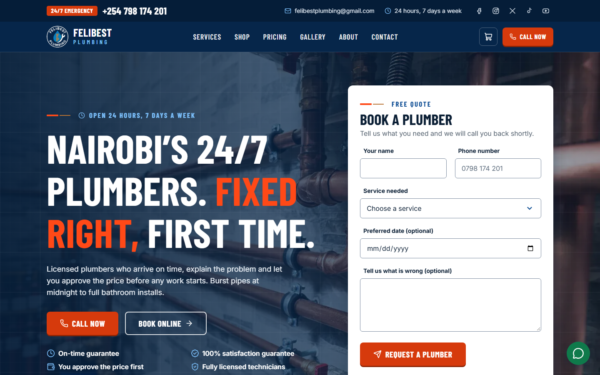
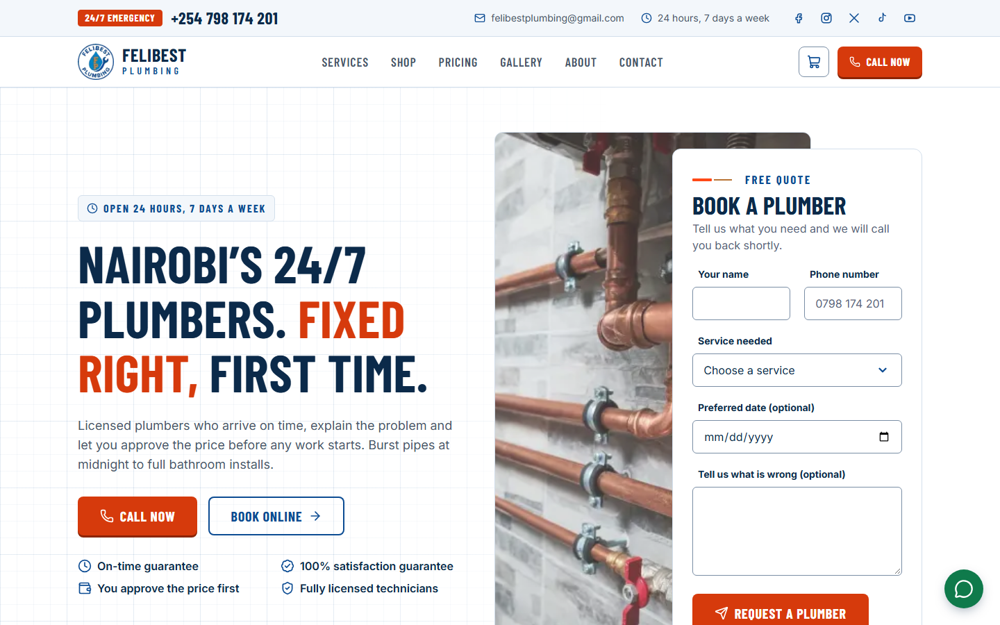
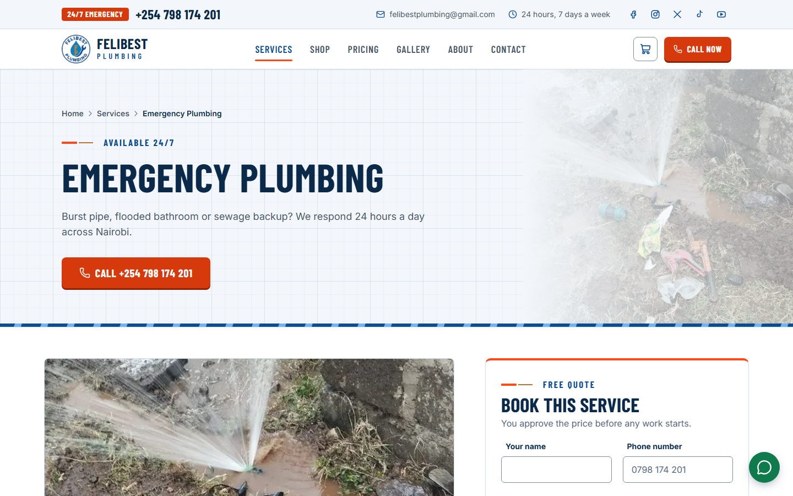
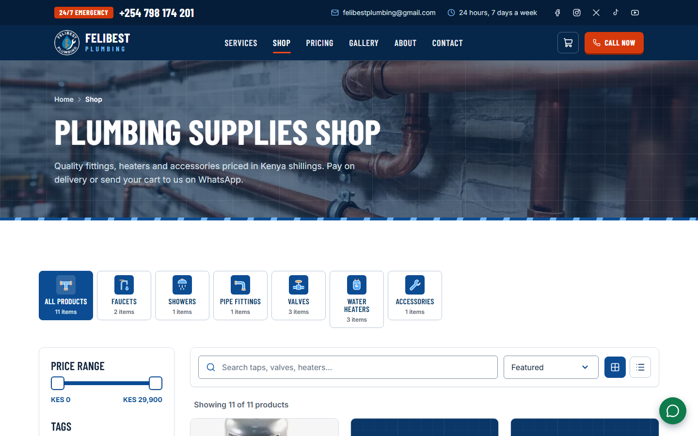
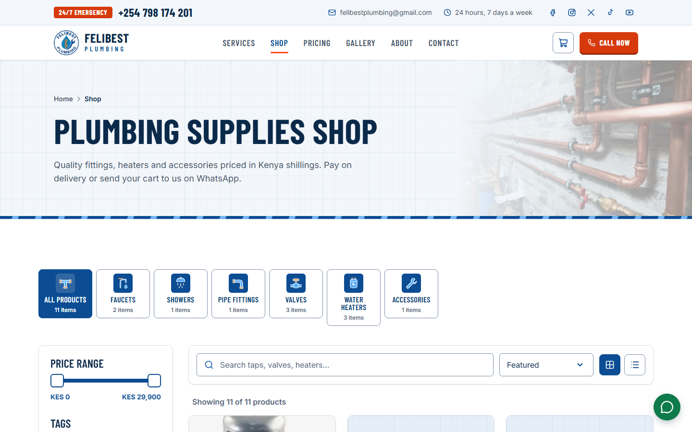

# Light vs dark: side by side

Two branches, same site. `revamp/plumbing-v2` is the approved dark navy design. `revamp/plumbing-v2-light` is the light theme plus WhatsApp orders. Switching branches switches the whole look; nothing else needs to change.

| | Dark navy (`revamp/plumbing-v2`) | Light (`revamp/plumbing-v2-light`) |
|---|---|---|
| Home |  |  |
| Service page |  |  |
| Shop |  |  |

Screenshots are the first screen at 1440 px, taken from production builds of each branch on the same database. Full-page screenshots of every route at 375, 768 and 1440 px are in `docs/screens-light/`. Lighthouse for both branches is in `docs/LIGHTHOUSE-V2-LIGHT.md`.

## Switch and run the light version

```bash
git switch revamp/plumbing-v2-light
npm run db:migrate        # adds two nullable WhatsApp columns to orders (safe to run repeatedly)
npm run dev               # http://localhost:3000
# production check
npm run build && npm start
```

## Switch and run the dark version

```bash
git switch revamp/plumbing-v2
npm run dev               # http://localhost:3000
# production check
npm run build && npm start
```

Notes:
- Commit or stash local changes before switching. `.env` and `data/` are not tracked, so they stay as they are.
- A database that has already been migrated by the light branch works with the dark branch: the two new columns are nullable and the dark code ignores them. A database created by the dark branch only needs `npm run db:migrate` on the light branch.
- Do not run a plain `npm i` or `npm ci` on this machine (better-sqlite3 will not compile). If dependencies must be reinstalled use `npm i --ignore-scripts`. Both branches use the same dependencies except none were added on the light branch.
- The dark logo (`logo-white.webp`) is still in `public/images/` on both branches; the light branch uses `logo-light.webp`.

## What differs

- Theme tokens: the `:root` block at the top of `src/app/globals.css`, and the component classes that used to hard-code navy blocks.
- Header, footer, mobile menu, hero, service cards, how-it-works, emergency band, CTA band, admin shell and charts.
- Light branch only: WhatsApp order redirect, `/og/product/[slug]` JPEG route, `OrderNotifier`, admin WhatsApp state, migration `0001`.
